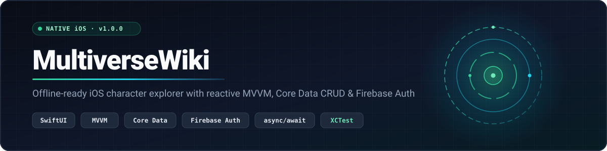
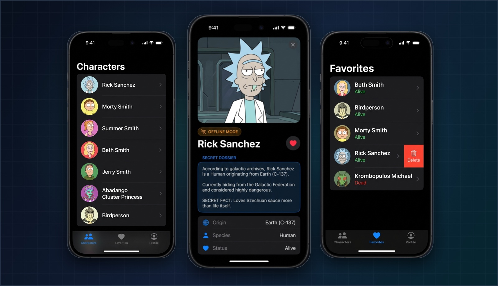
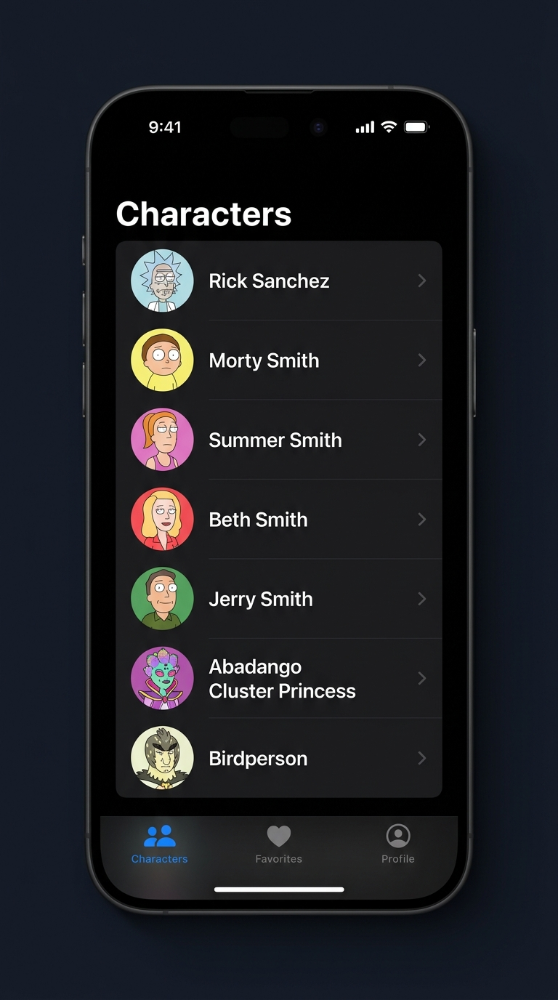
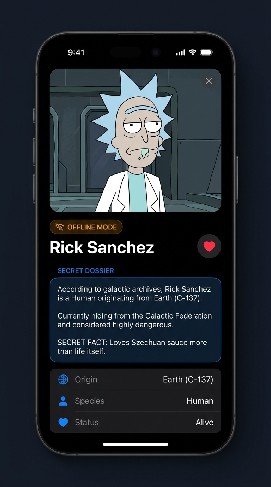
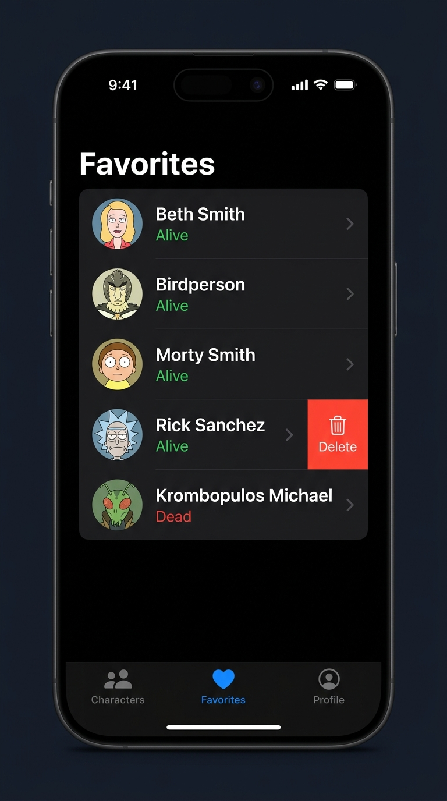
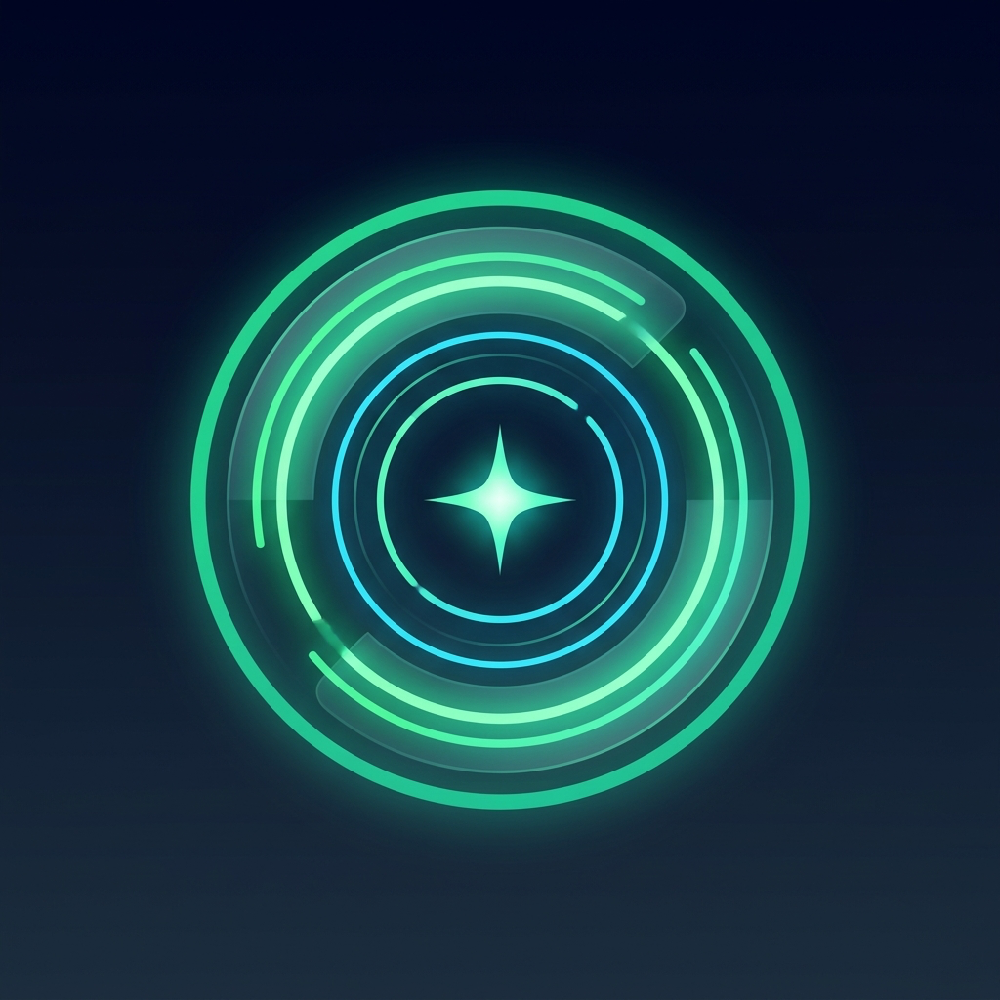
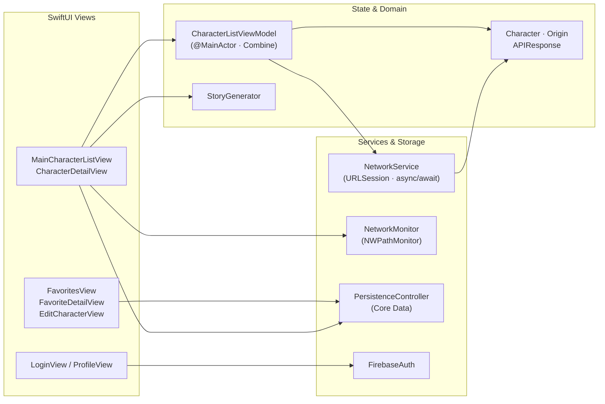

<p align="center">
  
</p>

<p align="center">
  
  
  
  
  
  
  <a href="./LICENSE">
    
  </a>
</p>

<p align="center">
  <strong>A production-structured native iOS application for exploring the Rick and Morty multiverse.</strong><br/>
  Built with SwiftUI, reactive MVVM, structured Swift concurrency (<code>async/await</code>), offline-first Core Data CRUD, Firebase Authentication, unified <code>OSLog</code> telemetry, and automated <code>XCTest</code> coverage.
</p>

<p align="center">
  <a href="#app-showcase">Showcase</a> ·
  <a href="#key-features">Features</a> ·
  <a href="#architecture">Architecture</a> ·
  <a href="#tech-stack">Tech Stack</a> ·
  <a href="#project-structure">Structure</a> ·
  <a href="#getting-started">Getting Started</a> ·
  <a href="#testing--quality">Testing</a> ·
  <a href="#engineering-documentation">Docs</a>
</p>

---

## App Showcase

<p align="center">
  
</p>

### Interface Walkthrough

| Directory & Infinite Scroll | Secret Dossier & Offline Mode | Offline Favorites (Core Data CRUD) |
| :---: | :---: | :---: |
|  |  |  |
| `MainCharacterListView` + `CharacterListViewModel` (`URLSession` `async/await` pagination, `Combine` search debounce, error recovery overlay) | `CharacterDetailView` + `StoryGenerator` + `NetworkMonitor` (deterministic ID-seeded lore, live `OFFLINE MODE` banner, Core Data favorite toggle) | `FavoritesView` + `EditCharacterView` (`@FetchRequest` sorted persistence, swipe-to-delete, context menu editing, offline detail access) |

<br/>

<table>
  <tr>
    <td width="110" align="center">
      
    </td>
    <td>
      <strong>App Identity &amp; Asset Catalog</strong><br/>
      Custom <code>1024×1024</code> portal-inspired iOS App Icon bundled directly in <code>MultiverseWiki/Assets.xcassets/AppIcon.appiconset/AppIcon.png</code> (universal, dark, and tinted appearances).
    </td>
  </tr>
</table>

---

## Overview

**MultiverseWiki** demonstrates end-to-end iOS engineering practices across authentication, REST pagination, local persistence, offline fault tolerance, and release documentation.

Rather than stopping at a basic API viewer, the repository separates SwiftUI presentation from business logic, persists full character dossiers into Core Data for offline browsing and editing, monitors live network reachability via `NWPathMonitor`, and ships with full architecture, QA, and release-readiness documentation under [`docs/`](./docs/).

---

## Key Features

| Capability | Engineering Implementation |
| :--- | :--- |
| **Firebase Authentication** | Email/password registration, sign-in, persistent session detection (`Auth.auth().currentUser`), and profile sign-out across `LoginView`, `ProfileView`, and `MultiverseWikiApp`. |
| **Infinite Character Directory** | Paginated fetching from `rickandmortyapi.com` via `NetworkService` (`URLSession` + `async/await`) with automatic next-page loading in `CharacterListViewModel.shouldLoadMore`. |
| **Debounced Search Pipeline** | Reactive `Combine` stream (`.debounce(for: .seconds(0.5))` + `.removeDuplicates()`) paired with case-insensitive filtering. |
| **Offline-First Favorites (Core Data CRUD)** | Full local persistence backed by `MultiverseData.xcdatamodeld` (`FavoriteCharacter` entity): heart toggle save/delete, offline `FavoriteDetailView`, swipe-to-delete, context menus, and inline editing via `EditCharacterView`. |
| **Deterministic Secret Dossiers** | `StoryGenerator` computes reproducible character lore seeded by `character.id` and vitality `status`, persisted alongside favorites for offline reading. |
| **Network Resilience & Recovery** | `NetworkMonitor` (`NWPathMonitor` + `Combine`) surfaces a live `OFFLINE MODE` indicator on character details, while initial load failures display an error overlay with one-tap `retry()`. |
| **Structured Observability** | Scoped `OSLog` loggers (`Logger.network`, `Logger.data`, `Logger.ui`) replace raw `print()` debugging with Apple's unified logging system. |

---

## Architecture

The project follows **MVVM (Model-View-ViewModel)** with strict unidirectional boundaries between SwiftUI views, `@MainActor` state management, and infrastructure services.



> See [docs/ARCHITECTURE.md](./docs/ARCHITECTURE.md) for sequence diagrams, concurrency guarantees, and layer-by-layer design notes.

---

## Tech Stack

| Layer | Technology | Role |
| :--- | :--- | :--- |
| **Language** | Swift 5 | Concurrency (`async/await`, `@MainActor`), `Codable`, value-type models |
| **UI Framework** | SwiftUI | Declarative views, `TabView`, `NavigationView`, `AsyncImage`, `matchedGeometryEffect` |
| **Reactivity** | Combine | Search debouncing (`0.5s`), `@Published` bindings, connectivity updates |
| **Networking** | `URLSession` | Paginated REST integration with HTTP status validation |
| **Persistence** | Core Data (`NSPersistentContainer`) | Offline favorites storage & local CRUD (`FavoriteCharacter`) |
| **Authentication** | Firebase iOS SDK (`12.9.0` via SPM) | Email/password auth & session persistence (`FirebaseCore`, `FirebaseAuth`) |
| **Connectivity** | `Network.NWPathMonitor` | Real-time online/offline path monitoring |
| **Observability** | `os.Logger` (`OSLog`) | Structured categorized logging (`Network`, `CoreData`, `UI`) |
| **Testing** | `XCTest` | Automated unit tests for logic, decoding, and ViewModel behavior |

---

## Project Structure

```text
MultiverseWiki/
├── MultiverseWiki/                  # App entry point, Firebase bootstrap & asset catalog
│   ├── MultiverseWikiApp.swift      # AppDelegate + Auth-gated WindowGroup + Core Data injection
│   └── Assets.xcassets/             # AccentColor & AppIcon assets
├── Models/
│   └── Character.swift              # APIResponse, Character, Origin (Codable, Identifiable)
├── ViewModels/
│   └── CharacterListViewModel.swift # Pagination, Combine search debounce, @MainActor loading & retry
├── Views/
│   ├── ContentView.swift            # TabView root + MainCharacterListView + error overlay
│   ├── LoginView.swift              # Firebase email/password Sign In & Sign Up
│   ├── CharacterDetailView.swift    # Character dossier, offline indicator & favorite toggle
│   ├── FavoritesView.swift          # @FetchRequest Core Data list with edit & delete actions
│   ├── FavoriteDetailView.swift     # Offline-safe saved character detail view
│   ├── EditCharacterView.swift      # Core Data modal form editor for saved favorites
│   ├── ProfileView.swift            # Authenticated user profile & sign-out
│   └── InfoRow.swift                # Reusable icon + label metadata row
├── Services/
│   ├── NetworkService.swift         # Async REST client for rickandmortyapi.com
│   ├── Persistence.swift            # NSPersistentContainer ("MultiverseData")
│   └── NetworkMonitor.swift         # NWPathMonitor observable reachability service
├── Helpers/
│   ├── StoryGenerator.swift         # Deterministic character dossier generator
│   └── Logger+Extension.swift       # OSLog subsystem & categories (network, data, ui)
├── MultiverseData.xcdatamodeld/     # Core Data model (FavoriteCharacter entity)
├── MultiverseWikiTests/
│   └── MultiverseWikiTests.swift    # Unit test suite (8 XCTest specs)
├── docs/                            # Architecture, QA log, release checklist & App Store metadata
├── assets/                          # Hero banner, studio showcase, UI previews & 1024x1024 App Icon
│   ├── banner.svg                   # Repository header banner
│   ├── showcase.jpg                 # 3-device studio showcase graphic
│   ├── app-icon.png                 # 1024x1024 iOS App Icon artwork
│   └── screens/                     # Individual SwiftUI screen previews (characters, dossier, favorites)
├── GoogleService-Info.plist.example # Firebase configuration template
├── CHANGELOG.md                     # Semantic release history
├── CONTRIBUTING.md                  # Contribution & testing standards
└── LICENSE                          # MIT License
```

---

## Core Data Schema

`MultiverseData.xcdatamodeld` defines the **`FavoriteCharacter`** entity for offline-first persistence:

| Attribute | Type | Notes |
| :--- | :--- | :--- |
| `id` | `Int64` | Maps to API `Character.id` for duplicate checks & toggling |
| `name` | `String?` | Character name (editable offline via `EditCharacterView`) |
| `status` | `String?` | Vitality status (`Alive`, `Dead`, `unknown`; editable offline) |
| `species` | `String?` | Character species |
| `gender` | `String?` | Character gender |
| `image` | `String?` | Avatar URL string |
| `story` | `String?` | Persisted deterministic Secret Dossier for offline viewing |

---

## Getting Started

### Prerequisites

- **macOS** with **Xcode** (Swift 5+ & iOS Simulator installed)
- A **Firebase project** with **Email/Password Authentication** enabled

### 1. Clone the Repository

```bash
git clone https://github.com/Alizhan-T/MultiverseWiki.git
cd MultiverseWiki
```

### 2. Configure Firebase

1. In the [Firebase Console](https://console.firebase.google.com/), register an iOS app using bundle identifier `com.Alizhka.MultiverseWiki` (or update the Bundle Identifier in Xcode Signing & Capabilities to match yours).
2. Enable **Authentication → Sign-in method → Email/Password**.
3. Download your `GoogleService-Info.plist` and place it in the project root (see [`GoogleService-Info.plist.example`](./GoogleService-Info.plist.example) for the expected structure).
   > `GoogleService-Info.plist` is listed in `.gitignore` so credentials are never committed to version control.

### 3. Open & Run in Xcode

1. Open `MultiverseWiki.xcodeproj` in Xcode.
2. Wait for Swift Package Manager to resolve `firebase-ios-sdk` (`12.9.0`).
3. Ensure `GoogleService-Info.plist` is added to the `MultiverseWiki` app target.
4. Select an iOS Simulator and press **`Cmd + R`** to build and launch.

---

## Testing & Quality

Run the unit test suite inside Xcode with **`Cmd + U`**, or from the terminal via `xcodebuild`:

```bash
xcodebuild test \
  -project MultiverseWiki.xcodeproj \
  -scheme MultiverseWiki \
  -destination 'platform=iOS Simulator,name=iPhone 16 Pro'
```

### Test Suite Breakdown (`MultiverseWikiTests`)

| Test Case | Target | Verification |
| :--- | :--- | :--- |
| `testStoryGenerator_Deterministic` | `StoryGenerator` | Identical output across repeated calls for the same `character.id` |
| `testStoryGenerator_UniqueSecrets` | `StoryGenerator` | Distinct dossier facts across different character IDs |
| `testStoryGenerator_DeadStatus` | `StoryGenerator` | Status-specific lore branch for `Dead` characters |
| `testStoryGenerator_AliveStatus` | `StoryGenerator` | Status-specific lore branch for `Alive` characters |
| `testCharacterDecoding` | `Character` | JSON decoding of full character payload & nested `Origin` |
| `testAPIResponseDecoding` | `APIResponse` | Wrapper decoding with API pagination metadata |
| `testViewModel_InitialState` | `CharacterListViewModel` | Clean initial state (`characters` empty, `isLoading == false`, `errorMessage == nil`) |
| `testViewModel_SearchFilter` | `CharacterListViewModel` | Accurate filtered result set when `searchText` updates |

---

## Engineering Documentation

| Document | Purpose |
| :--- | :--- |
| [docs/ARCHITECTURE.md](./docs/ARCHITECTURE.md) | Full MVVM architecture, Mermaid diagrams, auth sequence, Core Data schema & trade-offs |
| [docs/QA_LOG.md](./docs/QA_LOG.md) | Defect resolution log with root causes and verified fixes |
| [docs/RELEASE_CHECKLIST.md](./docs/RELEASE_CHECKLIST.md) | Pre-release verification matrix for `v1.0.0` |
| [docs/RELEASE_NOTES.md](./docs/RELEASE_NOTES.md) | Version `1.0.0` highlights, engineering upgrades & known limitations |
| [docs/STORE_LISTING.md](./docs/STORE_LISTING.md) | App Store Connect metadata draft & privacy summary |
| [CHANGELOG.md](./CHANGELOG.md) | Keep a Changelog formatted version history |
| [CONTRIBUTING.md](./CONTRIBUTING.md) | Branching conventions, coding guidelines & PR checklist |

---

## Roadmap

- [ ] Protocol-based dependency injection (`NetworkServicing` & in-memory Core Data store) for mocked service tests
- [ ] Server-side search endpoint integration (`/api/character/?name=`) across the full catalog
- [ ] Persistent disk-backed image cache for offline favorite thumbnails
- [ ] Automated CI workflow (SwiftLint + `xcodebuild test`) once runner Xcode versions align with the deployment target

---

## License & Author

Distributed under the **MIT License**. See [LICENSE](./LICENSE) for details.

Built by **[Alizhan Toleukhan](https://github.com/Alizhan-T)** · [Portfolio](https://alizhan-t.github.io/)
