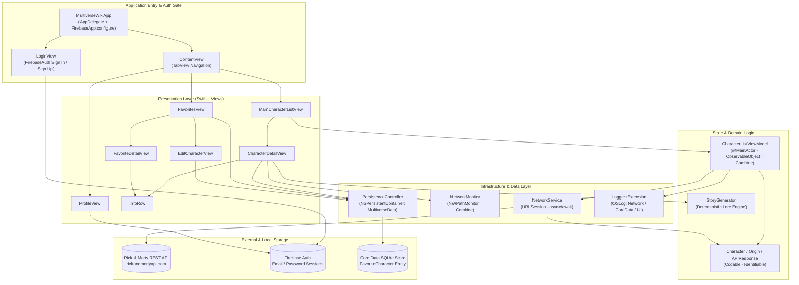
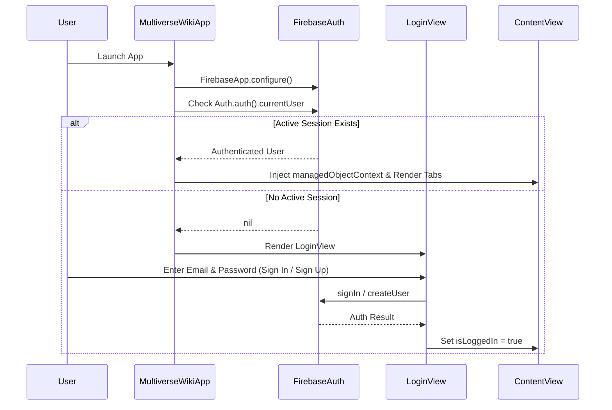

# Architecture Overview

**MultiverseWiki** is a native iOS application structured around **MVVM (Model-View-ViewModel)** with strict separation between SwiftUI presentation, reactive state management, networking, local persistence, and system telemetry.

---

## High-Level System Architecture

---

## Authentication & Navigation Flow

---

## Layer Breakdown

### 1. Application Entry (`MultiverseWiki/`)
- **`MultiverseWikiApp.swift`**: Configures Firebase via `UIApplicationDelegateAdaptor` (`AppDelegate`), initializes `PersistenceController.shared`, injects `managedObjectContext` into the SwiftUI environment, and gates root navigation between `LoginView` and `ContentView` based on Firebase Auth state.

### 2. Presentation Layer (`Views/`)
All views are declarative SwiftUI components with isolated responsibilities:
- **`LoginView.swift`**: Handles email/password authentication and account registration with inline validation and error display.
- **`ContentView.swift`**: Hosts the 3-tab navigation shell (`Characters`, `Favorites`, `Profile`) and `MainCharacterListView` with infinite scroll, async image loading, progress indicator, and full-screen network error recovery overlay.
- **`CharacterDetailView.swift`**: Displays full character dossier, `matchedGeometryEffect` hero image hook, live `OFFLINE MODE` indicator via `NetworkMonitor`, deterministic `StoryGenerator` output, metadata rows, and Core Data favorite toggle.
- **`FavoritesView.swift`**: Observes `FavoriteCharacter` records directly via `@FetchRequest` sorted alphabetically, supporting navigation to detail view, swipe-to-delete, and context menu actions (Edit / Delete).
- **`FavoriteDetailView.swift`**: Offline-safe detail view rendering persisted attributes and saved dossiers without network dependency.
- **`EditCharacterView.swift`**: Modal form sheet allowing users to modify saved favorite `name` and `status` fields directly in Core Data.
- **`ProfileView.swift`**: Displays the signed-in Firebase user email and handles session sign-out.
- **`InfoRow.swift`**: Reusable labeled icon-value metadata row component.

### 3. ViewModel & Domain Layer (`ViewModels/`, `Models/`, `Helpers/`)
- **`CharacterListViewModel.swift`**:
  - Manages `@Published` state (`characters`, `searchText`, `isLoading`, `errorMessage`).
  - Uses `Combine` (`.debounce(for: .seconds(0.5))` + `.removeDuplicates()`) on `$searchText` with case-insensitive `filteredCharacters` computation.
  - Controls pagination (`currentPage`, `canLoadMore`) via `shouldLoadMore(currentCharacter:)` and guarantees thread-safe UI updates with `@MainActor` on `loadData(reset:)`.
  - Exposes `retry()` for clean state reset and re-fetch on network failures.
- **`Models/Character.swift`**: Immutable `Codable` DTOs (`APIResponse`, `Character`, `Origin`) mapped from the Rick and Morty API JSON schema.
- **`Helpers/StoryGenerator.swift`**: Pure, deterministic lore generator that maps `character.status` and `character.id % secrets.count` to reproducible dossiers — enabling straightforward unit testing without mocking randomness.
- **`Helpers/Logger+Extension.swift`**: Extends Apple's `os.Logger` with scoped subsystem logging (`Logger.network`, `Logger.data`, `Logger.ui`).

### 4. Services & Persistence Layer (`Services/`, `MultiverseData.xcdatamodeld`)
- **`NetworkService.swift`**: Singleton REST client fetching paginated character payloads from `https://rickandmortyapi.com/api/character/?page=<N>` using `URLSession.shared.data(from:)`, validating HTTP `200`, and decoding via `JSONDecoder`.
- **`Persistence.swift`**: Wraps `NSPersistentContainer(name: "MultiverseData")` with `automaticallyMergesChangesFromParent = true`.
- **`NetworkMonitor.swift`**: Wraps Apple's `Network.NWPathMonitor` on a dedicated background `DispatchQueue` and publishes connectivity changes (`isConnected`) on the main thread.

---

## Core Data Schema (`MultiverseData`)

Entity: **`FavoriteCharacter`** (`codeGenerationType="class"`)

| Attribute | Core Data Type | Optional | Purpose |
| :--- | :--- | :---: | :--- |
| `id` | `Integer 64` | Yes | Unique character identifier matching API `Character.id` |
| `name` | `String` | Yes | Display name (editable via `EditCharacterView`) |
| `status` | `String` | Yes | Character vitality status (`Alive`, `Dead`, `unknown`; editable) |
| `species` | `String` | Yes | Character species |
| `gender` | `String` | Yes | Character gender |
| `image` | `String` | Yes | Remote avatar URL |
| `story` | `String` | Yes | Persisted deterministic Secret Dossier text for offline reading |

---

## Concurrency & Error Handling Strategy

- **Structured Concurrency**: Remote requests execute via Swift `async/await` initiated from `.task` modifiers and `Task` blocks; state updates are serialized on `@MainActor`.
- **Network Failure Recovery**: `NetworkService` throws `URLError(.badServerResponse)` on non-200 HTTP responses; `CharacterListViewModel` captures errors, logs them via `Logger.network.error`, and exposes `errorMessage` to trigger the retry overlay in `MainCharacterListView`.
- **Offline Availability**: Saving a character persists its metadata and generated story in Core Data so `FavoritesView` and `FavoriteDetailView` remain fully functional without connectivity.

---

## Architectural Trade-Offs & Future Refinements

- **Dependency Injection**: `NetworkService.shared` and `PersistenceController.shared` currently use singletons for simplicity; introducing protocol-backed DI (`NetworkServicing`, in-memory `NSPersistentContainer` for tests) will allow full mock-network and persistence unit tests.
- **Image Caching**: `AsyncImage` relies on default `URLCache`; adopting a dedicated disk/memory cache would make saved avatars resilient across cold offline launches.
- **Server-Side Search**: Search currently filters loaded pages client-side; integrating `/api/character/?name=<query>` would unlock full-catalog search across all 800+ characters.
